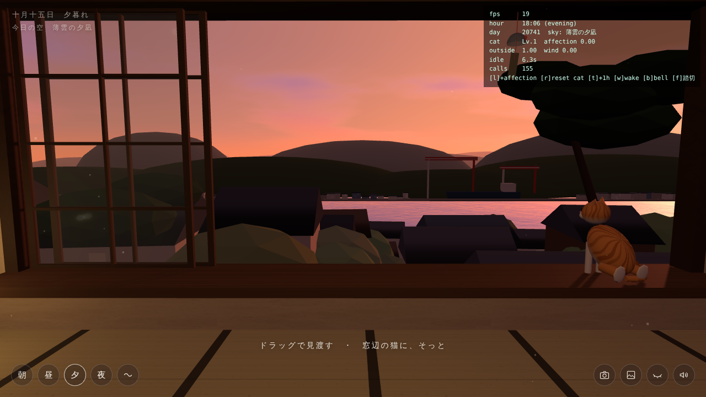
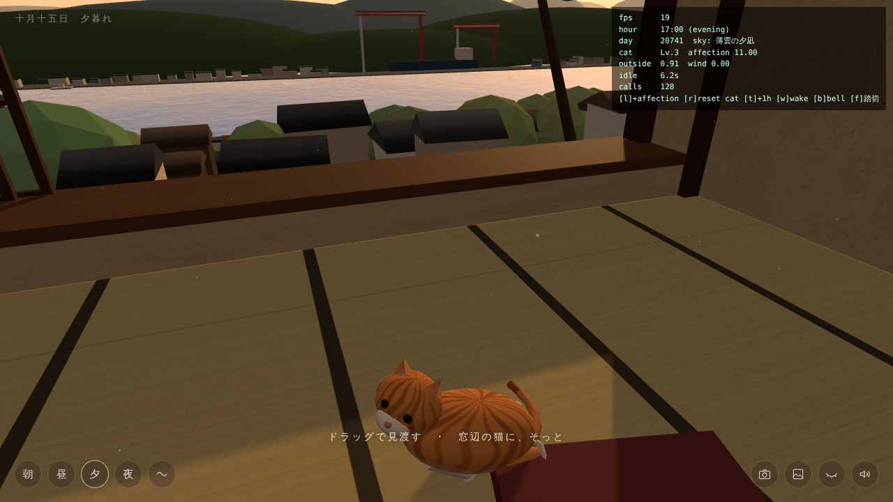

# 坂道の空き家、尾道にて（技術検証プロトタイプ）

尾道水道を臨む坂の上の空き家で「何もしないをする」チルゲームの、Three.js による技術検証用 Web プロトタイプです。
ビルド不要で、静的ファイルを配信するだけで動きます。

| 夕暮れ | 猫 Lv.3 |
| --- | --- |
|  |  |

（スクリーンショットは `?debug` 表示つき）

## 遊ぶ

**https://kafui-133.github.io/Onomichi-chill/** （GitHub Pages。PC・スマホのブラウザでそのまま遊べます）

## 起動方法（手元で動かす）

ES Modules と importmap を使っているため、`file://` ではなくローカルサーバーで開いてください。

```bash
python3 -m http.server 8000
# → http://localhost:8000/
```

Three.js（r160）は jsDelivr の CDN から読み込みます。音はすべて Web Audio API で合成しているので、音声ファイルはありません。

### URL パラメータ（検証用）

| パラメータ | 内容 |
| --- | --- |
| `?hour=18.2` | 開始時刻を指定（既定は 16:54。夕暮れに入る少し前） |
| `?debug` | FPS・時刻・猫の親密度などを表示。キー操作: `1` 親密度+2 / `2` 猫をリセット / `3` +1時間 / `4` 引き波の音 / `5` 鐘 / `6` 踏切 / `7` 電車を走らせる |

## 操作

- **ドラッグ**：部屋の中（文机・箪笥・柱時計）と窓の外をゆるやかに見渡す（慣性つき）。ホイールで少し寄る。矢印キーでも動かせます
- **猫をクリック**：そっと触れる／**長押し**：なでる
- **朝・昼・夕・夜**：その時刻まで、時間が先へ進むかたちでゆっくり移り変わる
- **〜**：時の流れに任せる（1分でゲーム内の1時間。夕暮れどきはさらにゆっくり）／時を止める
- **カメラ**：写真を撮る（フィルム風に現像して日付を写し込む → 保存できる）
- **アルバム**：このセッションで撮った写真
- **日記**：その日に歩いた場所、出会った猫、食べたもの、乗ったロープウェイ、夕方の空の名前、撮った写真から下書きを作ります。自分のことばに書きかえて「書きとめる」と、最初の1枚の写真といっしょに手帳にしまわれます（ブラウザに保存、最大60日分）
- **出会った猫図鑑**：町で出会った猫（家の猫を入れて10匹）の名前・毛色・居場所・親密度レベル（Lv.1 警戒〜Lv.4 信頼）と、懐くにつれてわかってくること。まだ会っていない猫は「？？？」と居場所のヒントだけ。なでたり、そばでしゃがんで静かに待ったりすると懐いていき、Lv.4 になった猫は地図に顔の印が載って、押すと（または図鑑の「会いにいく」で）その猫のところへすぐ行けます
- **目を閉じる**：画面が暗くなり、環境音だけに集中するモード（クリックか Esc で目をあける）
- **音（右下のスピーカー）**：音量のつまみと「消す／出す」。はじめは中くらい（50）で、設定はブラウザに覚えておきます
- 何も触らずにいると、UI は自動で消えて景色と音だけになります

### スマホで遊ぶ
- 同じページがスマホにも対応しています（縦持ち・横持ちどちらでも）。指でドラッグして見渡し、猫は長押しでなでます
- 町では画面下の大きな「歩く」ボタンを親指で押しながら、もう片方の指でドラッグして向きを変えます
- 縦持ちでは、時間帯のボタンは右上、操作ボタンは下の中央にまとまります。地図は横にスクロールでき、開いたときに現在地が真ん中に来ます
- 何もしないでいるとボタンが消えます。画面をひとたたきすると戻ります
- iPhone では、本体の消音スイッチが入っていると音が鳴りません
- スマホでは音割れを防ぐため、音声バッファを大きめにとり、スピーカーで歪みやすい 80Hz 以下を切り、最後にリミッターをかけています。短い効果音の数も少し減らしています

### 町を歩く
- **戸のボタン（右下）**：家の外へ出る。戸口は家の東側にあり、そこから千光寺新道の石段が下っています
- **W / ↑**：前へ　**S / ↓**：うしろへ　**A・D**：横へ　**← →**：向きを変える　**ドラッグ**：見回す
- **「歩く」ボタン**：押しているあいだ前へ歩く（スマホ・タッチ用）
- **地図（右下、または M）**：道のつながりと名所を表示。印か名前を押すと、その場所へ移動
- **E / Enter、または画面下のボタン**：戸口で「家に入る」、海岸通りのベンチで「座る」「立ちあがる」、猫のそばで「しゃがむ」。できることが重なる場所（ロープウェイ山麓駅前の自販機など）では、ボタンが並んでどれでも選べます（E / Enter はいちばん左）
- **C**：しゃがむ／立ちあがる。しゃがむと目線が猫の高さになり、静かに待っていると猫がこちらを見て、鼻先を寄せたり、ゆっくりまばたきしたりします
- **千光寺山ロープウェイに乗る**：山麓駅・山頂駅の前で「ロープウェイに乗る」。実際と同じく片道およそ3分、ゴンドラから町と尾道水道を見下ろしながら上り下りします。乗っているあいだは「すぐに山頂駅へ／すぐに山麓駅へ」で到着まで飛ばせます
- **千光寺山の頂上**：山頂駅から石段を少し上ると頂上の展望台。「展望台にのぼる」で、尾道水道・向島・瀬戸内の島々を見わたせます（地図の「千光寺山 頂上（展望台）」からも行けます）
- 渡船は実際のように、ゆっくり（約1.8m/s、片道2〜3分）渡ります
- 道の上を歩けます。海沿いや町なかの平地では、道の外（広場・駅前・岸壁ぞい）も歩けます（建物の中や海には入れません）。地図データで道の端が数メートル途切れているところは、短い小径・石段でつないでいます。石段・タイル・アスファルトで足音が変わり、商店街では足音が少し響きます
- 町の野良猫（猫の細道の上と下、ロープウェイ山麓駅のそば、商店街の店先、海沿いのベンチの横と板張りのベンチの上、家の前の石段、千光寺の境内、天寧寺 三重塔のそば）にも触れられます。茶トラ・サバトラ・キジトラ・ハチワレ・三毛・白・茶白・黒と、毛色もいろいろ。懐き具合は猫ごとに保存されます

### 食べる・飲む（お金の概念はありません）
- **パン屋**（本通り商店街に2軒）：メロンパン・あんぱん・クリームパン・塩パン・カレーパン・はっさくデニッシュ。選ぶと持ち物に入ります
- **尾道ラーメン**（本通り商店街に2軒）：お店の前で「〜で食べる」。鶏ガラと魚介の醤油スープ、背脂、平打ちの細麺を、すすりながら食べます
- **坂の途中の小さなパン屋「そのてパン」**（猫の細道の中ほど）：猫の手のかたちの肉球パン、坂道カスタード、あんぱん、はっさくデニッシュ
- **かまぼこ屋「かまぼこ 潮見」**（本町センター街）：紅白の板かまぼこ、揚げたて天ぷら、焼きちくわ、魚のコロッケ。食べ歩きにも
- **おやつのウミネコ**（尾道駅前）：小さな瓶入りの尾道プリン（茶色のふた、赤い帯）。食べるときに、添えてあるレモンソースを「かける／そのまま」から選んで、4口で
- **尾道マロン珈琲**（一番街）：お店でひとやすみ。丸い厚焼きのワッフルに、とけていくバター
- **自販機**（海沿いのベンチの近く、渡船のりば、ロープウェイ山麓駅、駅前、路地の入口など）：缶コーヒー（あったか〜い／つめた〜い）、みかんジュース、緑茶、ラムネ、ミルクティー。缶コーヒーは、プシュッと開けてから缶を4回タップ（クリック）してひとくちずつ飲みます
- **海沿いの景色**：遊歩道には緑の柱に乳白の玉がふたつの街灯（夜はオレンジに灯る）、尾道渡船ののりばには緑の屋根のアーチ「向島行渡船のりば」、向島の造船所のクレーンはうすい青緑色。日によっては、秋らしいうろこ雲が空いっぱいに広がります
- **海沿いのベンチ**：尾道水道に向いたベンチが、岸壁ぞいに20mあまりおきに並んでいます。木の背もたれつきのものと、雨風で銀色になった板張りの広い腰掛けの2種類
- **持ち物（右下のかばん、または B）**：いつでも食べたり飲んだりできます。歩きながらの食べ歩きも、ベンチに座ってのひとやすみも。最大12個まで、ブラウザに保存されます

## ファイル構成

```
tools/
  fetch_data.py       OpenStreetMap と国土地理院の標高を取得
  build_town_data.py  ゲーム用データに変換
index.html        画面の骨組み、importmap、ミニマル UI（ボタンは SVG アイコン）
style.css         ミニマルデザイン、タイトル／目を閉じる／写真プリントの演出
js/
  main.js         エントリポイント。レンダラ・ライト・各システムの接続とメインループ
  timeOfDay.js    時刻キーフレームの補間、太陽と月の軌道、日替わりの夕暮れの「性格」
  sky.js          空のシェーダー（グラデーション・太陽・fbm の雲・星・月）、海面のシェーダー
  world.js        遠景：向島の街と造船所クレーン、尾道大橋、瀬戸内の島影
  data/onomichi.js 実データから変換した町のデータ（tools/build_town_data.py が生成）
  townMap.js      地図データの読み込み：地形の高さ、歩ける道、地名、踏切・渡船・ベンチの位置、当たり判定
  town.js         歩ける町の3D：地形、道、石段と石垣、建物、アーケード、線路と踏切、電車、ロープウェイ、名所、渡船のりば
  townKit.js      看板の文字テクスチャ、四角形のまとめ描き、InstancedMesh のタイル分け
  walker.js       町歩きの移動（道の上と、町なかの平地を歩ける）と足音
  mapView.js      手帳風の地図と、名所・懐いた猫への移動
  zukan.js        出会った猫図鑑（毛色の顔の絵、親密度、居場所）
  diary.js        日記（その日のできごとから下書き、保存）
  items.js        食べもの・飲みものの品書き、持ち物、品物の絵
  food.js         パン屋・ラーメン屋・かまぼこ屋・おやつの店・喫茶店・自販機と、食べる・飲む流れ
  boats.js        渡船（向島との往復）、漁船、貨物船。通過イベントと引き波
  room.js         古民家の一室：畳・土壁・襖・文机と小物・風鈴・柱時計・吊り下げ電球
  cat.js          猫のモデル、ポーズのブレンド、親密度の4段階ロジック
  audio.js        Web Audio による環境音の合成と、視線に応じたミックス
  controls.js     主観視点の見渡し、猫へのクリック／長押しの判定
  photo.js        撮影した画面をフィルム風に現像する
  util.js         補間関数、シード付き乱数、Canvas テクスチャ生成など
```

## 実装のポイント（ステップごと）

### 1. 画面構成・カメラワーク（`room.js` / `world.js` / `controls.js`）
- カメラは座布団に座った目の高さ（y=1.08m）。窓の外の地面は約 60m 下に海がある想定で、坂の家並み → 尾道水道 → 向島 → 霞む瀬戸内の島影と重ねています。
- 窓の開口部は壁を4つの箱で組んでおり、窓枠・ガラス戸の桟・軒が太陽光の影として畳に落ちます（影は部屋の範囲だけに限定）。
- `LookControls` は yaw/pitch を目標値へ指数減衰で近づけるので、ドラッグの動きがゆるやかになります。呼吸のような微小な揺れも加えています。

### 2. 時間の移り変わりと夕暮れのグラデーション（`timeOfDay.js` / `sky.js`）
- 0〜24時の11個のキーフレーム（天頂・中間・地平線・太陽・雲・海・環境光・照明…）を smoothstep で補間します。
- 夕方は 17.4 → 18.2 → 18.8 → 19.5 時のキーで、**オレンジ → 茜 → 紫 → 濃紺**と変化します。
- **日替わりの夕暮れ**：日付をシードにして「茜空／金色の凪／藤色の宵／桃色の雲／薄雲の夕凪／燃える夕焼け」から1つを選び、色相・彩度・紫の強さ・雲量をずらします。夕暮れになると左上に「今日の空」が表示されます。
- 空はフルスクリーンの球に描くシェーダーです。地平線の焼けは太陽の方位に集中させ、雲は fbm ノイズを天球に投影して下から照らしています。
- 海面シェーダーは、波の法線から空のグラデーションを反射（フレネル）させ、太陽と月の光の道、船の V 字の引き波を描きます。
- ライトは `NoToneMapping` にして、設計した空の色がそのまま出るようにしています。霧の色を地平線の色に合わせているので、遠景は空に溶け込みます。

### 3. 環境音（`audio.js`）
外の音と内の音を別々のバスにまとめ、**視線が窓の外を向いているほど外のバスが大きく**なります。

| 外の音 | 内の音 |
| --- | --- |
| 波のうねりとチャプチャプ、**船が通ったあと数秒遅れて岸に届く引き波** | 部屋の静けさ（ルームトーン） |
| 風と突風（風鈴の揺れと連動）、軒を抜ける風の音 | 柱時計のチクタク |
| 朝のスズメ、昼のトンビ「ピーヒョロロ」、秋の夜の鈴虫 | 風鈴（部屋鳴りのリバーブつき） |
| 夕方6時と朝6時のお寺の鐘（うなりを含む余韻）、遠い踏切と電車、汽笛、ポンポン船 | 猫のゴロゴロ・鳴き声・シッポのペシペシ |

「目を閉じる」と、外と内の両方のバスが開いて全体が少し近くなります。

### 4. 猫のインタラクション（`cat.js`）
親密度（localStorage に保存）のしきい値で4段階に変化します。

| Lv | 親密度 | ふるまい |
| --- | --- | --- |
| 1 警戒 | 0〜 | 窓辺に座って海を見ている。触れるとちらりと振り向き、耳を伏せてまた海を見る。構いすぎると「びくっ」として親密度が少し下がる |
| 2 関心 | 4〜 | 窓辺からひょいと降りて近くに来て座り、こちらを見る。ときどき鳴く |
| 3 慣れ | 10〜 | 足もとで香箱座り。シッポでペシペシ（音つき）、触れるとゴロゴロ言いながらゆっくりまばたき |
| 4 信頼 | 18〜 | となりの座布団で丸くなって眠る。小さな寝息のゴロゴロ |

親密度の増え方：クリック +1（連打は無効）、長押しは毎秒 +0.75（Lv1 では短時間だけ）。**何も操作せずに猫を眺めているだけでも少しずつ上がる**ようにして、「何もしないをする」ことを肯定しています。

### 5. UI / デザイン
- ゲージや HP バーはありません。左下に時間帯、右下に「外へ出る・地図・持ち物・写真・アルバム・日記・猫図鑑・目を閉じる・音」の丸ボタン（スマホでは2段に折り返します）だけを置いています。
- 写真は、S字のトーンカーブ・色かぶり・粒子・周辺減光・光漏れ・オレンジの日付写し込みで、フィルム風に現像します。

### 6. 町歩き：実際の尾道の地図データ（`townMap.js` / `town.js` / `walker.js` / `mapView.js`）
町は **OpenStreetMap の道・建物・線路・海岸線** と **国土地理院の標高（DEM5A、5m メッシュ）** から組み立てています。

```
python3 tools/fetch_data.py        # 実データを tools/raw/ に取得（Overpass API・国土地理院タイル）
python3 tools/build_town_data.py   # ゲーム用の js/data/onomichi.js（約640KB）に変換
```

- 座標の原点は空き家です。東土堂の千光寺山の中腹（中村憲吉旧居の約60m南）で、標高から「南に尾道水道が開けていて、小径に近い」場所を探して置いています。床の標高は約63m。
- **地形**：DEM をそのまま地面にしています（町なかは5m、遠く・向島側は10mの細かさ）。向島の丘も実際の形です。
- **道**：OpenStreetMap の道を、地面メッシュと同じ三角形で高さをとった帯として敷き、空き家からつながっている道（約750本）だけを歩けます。アスファルト・タイル・石畳で模様が違います。
- **石段**：階段（steps）と急な小径は、蹴上げ約17cmごとに水平な踏み面を置いた本物の階段にし、長い石段には手すり、両側に石垣、端に小さな石灯籠（夜に灯る）を置いています。
- **商店街の路地**：アーケードから約30mごとに、海側にも坂側にも抜けられる細い石畳の路地を通しています。
- **本通り商店街**：屋根付き（covered）の通り（駅前商店街・一番街・中商店街・本町センター街）にアーケードの屋根と店先を並べています。店名は架空です。
- **建物**：OpenStreetMap の約1,300棟の輪郭を立ち上げ、小さな家は瓦の寄棟屋根にしています。データにない斜面の家並みは、道をよけて小さな家で補っています。空き家の窓からの眺めをふさがないよう、窓の前の建物と木は低く抑えています。
- **線路と踏切**：JR山陽本線の実際の線形を電車が走り、歩ける道と線路が交わる19か所に踏切を置いています。
- **千光寺山ロープウェイ**：山麓駅・山頂駅の実際の位置。片道およそ3分。
- **渡船**：尾道渡船（土堂↔兼吉）、福本渡船（土堂↔小歌島）、駅前渡船（駅前↔富浜）の3航路を、実際の桟橋の間で行き来します。ほかの船は水道の中心線にそって行き交います。
- **名所**：天寧寺の三重塔、艮神社、千光寺は OpenStreetMap の位置に置いています。
- 地図データ © OpenStreetMap contributors（ODbL）、標高 国土地理院 基盤地図情報（DEM5A）。

## データ・素材と権利

- **地図データ**：© [OpenStreetMap contributors](https://www.openstreetmap.org/copyright)。`js/data/onomichi.js` は OpenStreetMap のデータを加工したデータベースで、[Open Database License (ODbL) 1.0](https://opendatacommons.org/licenses/odbl/1-0/) で提供します。作り方は `tools/` のスクリプトのとおりです
- **標高**：国土地理院の[標高タイル](https://maps.gsi.go.jp/development/ichiran.html)（DEM5A）を加工して作成（[国土地理院コンテンツ利用規約](https://www.gsi.go.jp/kikakuchousei/kikakuchousei40182.html)に基づく出典の明示）
- **Three.js**：MIT License（CDN から読み込み）／ **フォント**：しっぽり明朝（SIL Open Font License、Google Fonts）
- **音・絵**：すべてプログラムで合成・描画しています（音声ファイル・画像素材は使っていません）
- 実在の町並み・地名・公共の施設（寺社、ロープウェイ、駅、渡船、商店街の通り名）をもとにしたフィクションです。**お店・猫・人物はすべて架空**で、実在のお店とは関係ありません

## 次のステップ（企画書より）
- 渡船に乗って向島へ渡る、浄土寺方面への延長、ロケーション別の立体音響（PannerNode / HRTF）
- 猫図鑑（シルエット → 写真を撮ると水彩イラストで埋まる）
- 拾った小物を窓辺や机に「ちょこんと置く」インテリア
- 手帳のオートログ、季節のイベント（ベッチャー祭り、花火大会）
- 雨・天候システム、ゲームパッドの振動でゴロゴロを表現
